# devicelab

[](https://github.com/OwaisMunawar/devicelab/actions/workflows/ci.yml)


**An open-source control plane for running automated workflows across a distributed fleet of iPhones and simulators: device inventory and health, exclusive leasing, a prioritised job queue, workflow templates, schedules, error recovery, artifacts, alerts and a live React dashboard.**

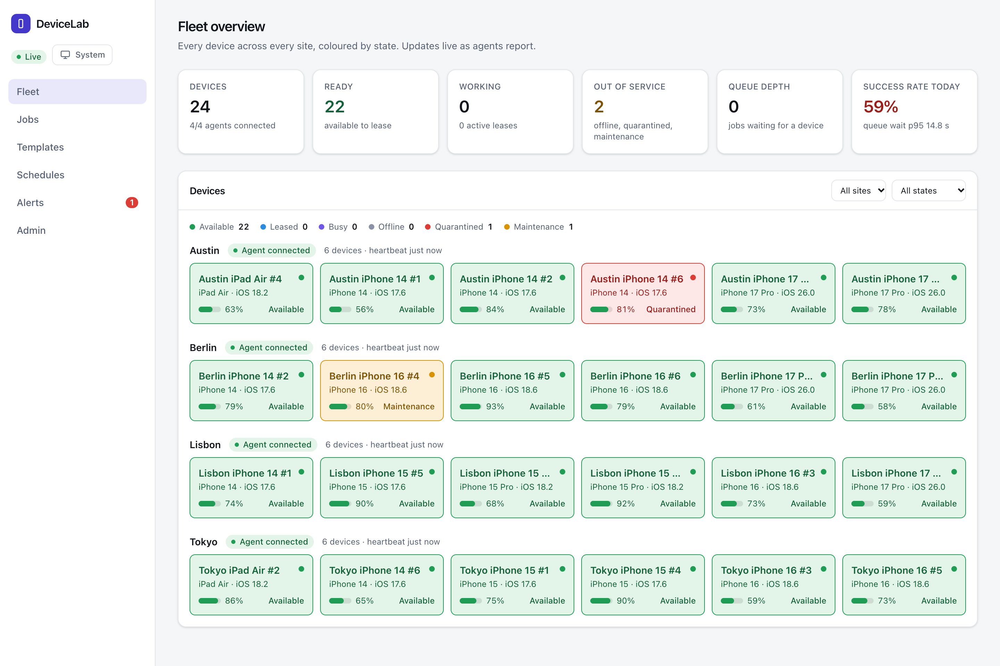

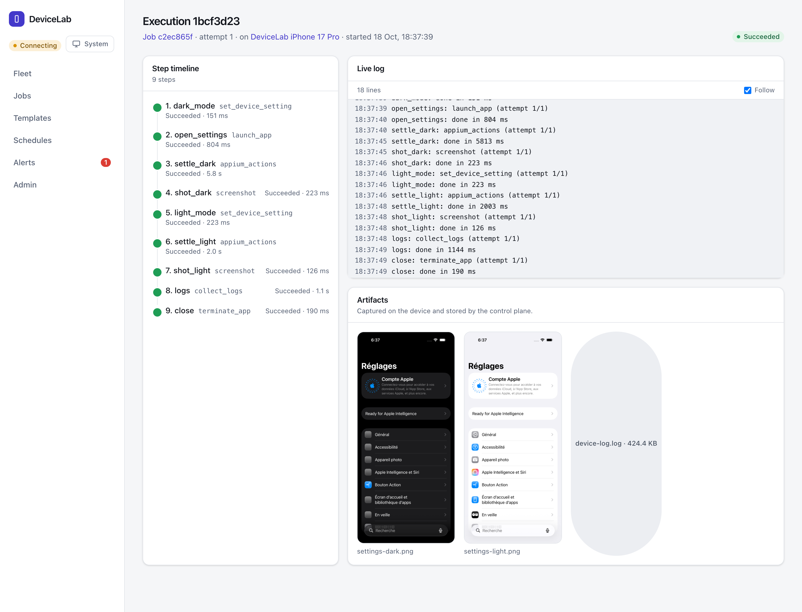

*The second screenshot is a real run: the control plane, a host agent, the simulator provider and Appium/WebDriverAgent driving Settings on an iOS 26.5 simulator, with the screenshots Appium captured shown as artifacts.*

## Why

Test benches of real iPhones tend to start as a shelf and a shell script. Then there are ten devices in three offices, somebody's run is clobbering somebody else's, a phone has been offline since Tuesday and nobody knows, and a "flaky" suite is really one device with a bad cable. The tools that exist solve a slice of this: Selenium Grid and Appium Grid route sessions, STF shares devices with humans, cloud farms rent you the hardware. None of them is a small, self-hostable system that treats **device allocation, health and recovery** as the core problem.

devicelab is that system. It does allocation correctly (exclusive leases with fencing), keeps working when machines and networks misbehave (outbound agents, requeue, quarantine), and keeps the operator informed (dashboard, alerts, audit log).

## What this is, and what it is not

**It is** a QA, device-lab and test-automation orchestration platform: run a smoke test on every iPhone in a lab, capture App Store screenshots across locales and devices, collect logs and artifacts, schedule it nightly, and see what failed and why.

**It is not** a tool for anything else. In particular there is nothing here, and nothing planned, for evading platform or anti-abuse detection, rotating accounts or farming multiple accounts, spoofing device fingerprints or location, rotating proxies per device, mass posting or engagement automation, or bypassing app or OS restrictions. Workflow steps are an allow-list of testing actions (see below); the agent will not run anything outside it.

## Features

- **Fleet inventory and health.** Hosts, sites and regions, devices with model, iOS version, UDID, battery, storage, thermal state, connectivity and last-seen; labels; states `available`, `leased`, `busy`, `offline`, `quarantined`, `maintenance`. A missed heartbeat marks a device offline and triggers recovery.
- **Scheduling and allocation.** Jobs ask for devices by capability (iOS range, model family, site or region, labels, count). Priority queue with aging, per-host concurrency limits, multi-device jobs, exclusive leases with a TTL renewed by heartbeat, automatic reclaim from dead agents. No double assignment, enforced by a database index and tested under concurrency.
- **Workflow engine.** YAML or JSON templates validated by Pydantic; typed steps from an allow-list (`install_app`, `launch_app`, `terminate_app`, `appium_actions`, `screenshot`, `capture_screenshots`, `collect_logs`, `set_device_setting`, `reboot_device`); parameters; step timeouts; retry with backoff and jitter; `continue_on_error`; a failure policy. Four examples in `examples/templates/`.
- **Error recovery.** Failures are classified (device unreachable, WDA crashed, app crashed, assertion failed, timeout). Recovery: restart the automation session, reboot the device, requeue on a different device, quarantine after N consecutive infrastructure failures, operator "return to service". Everything is audit-logged.
- **Schedules.** Cron with time zones and a skip or run-once misfire policy; recurring work enqueues idempotent jobs.
- **Artifacts.** Screenshots, logs and results per execution behind a storage interface (local filesystem, S3-compatible) with retention.
- **Alerts and reports.** Rules for device offline, failure rate, queue wait over SLA and lease reclaimed; HMAC-signed Slack-compatible webhooks and an in-dashboard feed, deduplicated with a cooldown; a daily summary endpoint and CSV export.
- **API.** Versioned REST (`/v1`), OpenAPI, hashed API keys with admin / operator / viewer roles, idempotency keys, pagination, filters, a typed error envelope, an append-only audit log enforced by a database trigger.
- **Observability.** JSON logs with correlation ids, Prometheus `/metrics`, live per-execution log streaming.
- **Dashboard.** Fleet grid by site, device detail, jobs and queue, job attempts, execution detail, templates with live validation, schedules, alerts, API keys and audit log. Light and dark themes, keyboard and screen-reader friendly.
- **Demo mode.** `docker compose up` seeds 24 simulated devices across 4 sites, templates, schedules and a week of history including failures and recoveries.

| | |
| --- | --- |
| 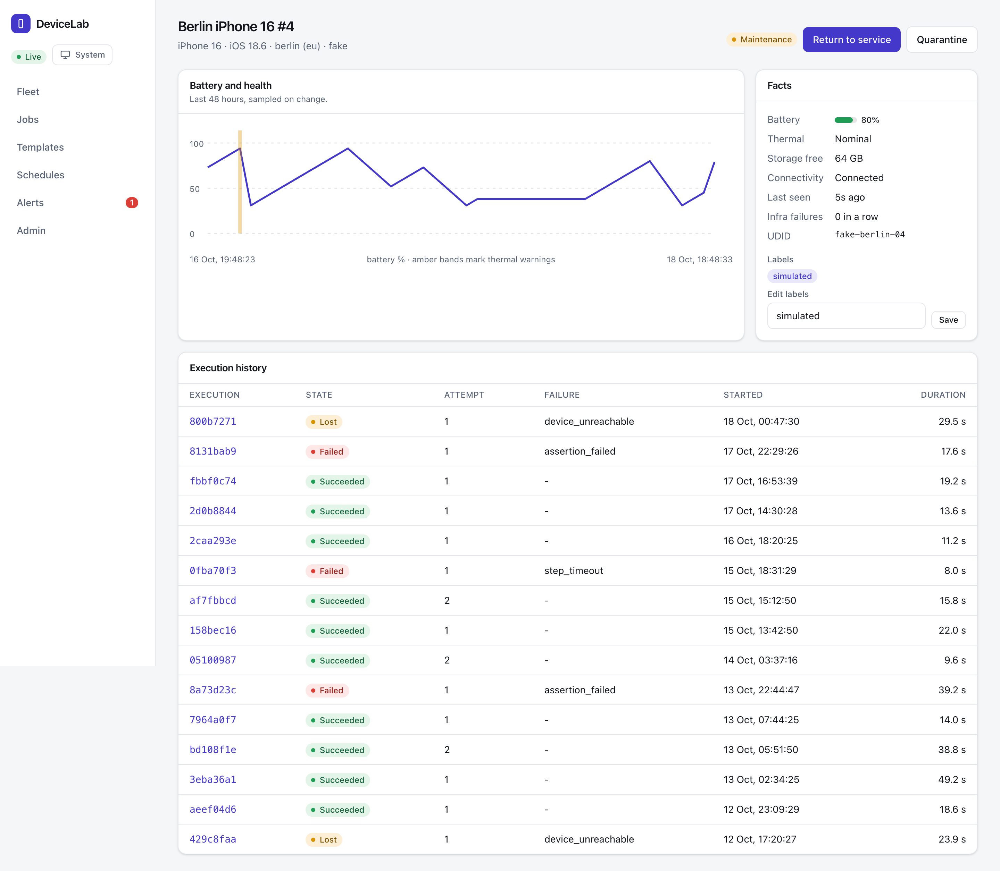 | 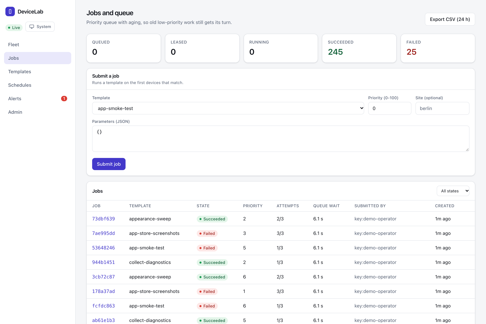 |
| 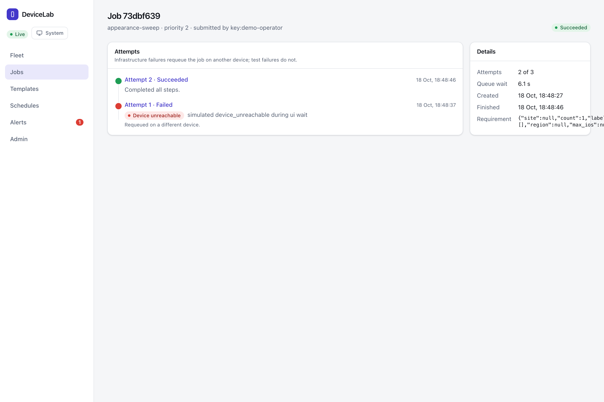 | 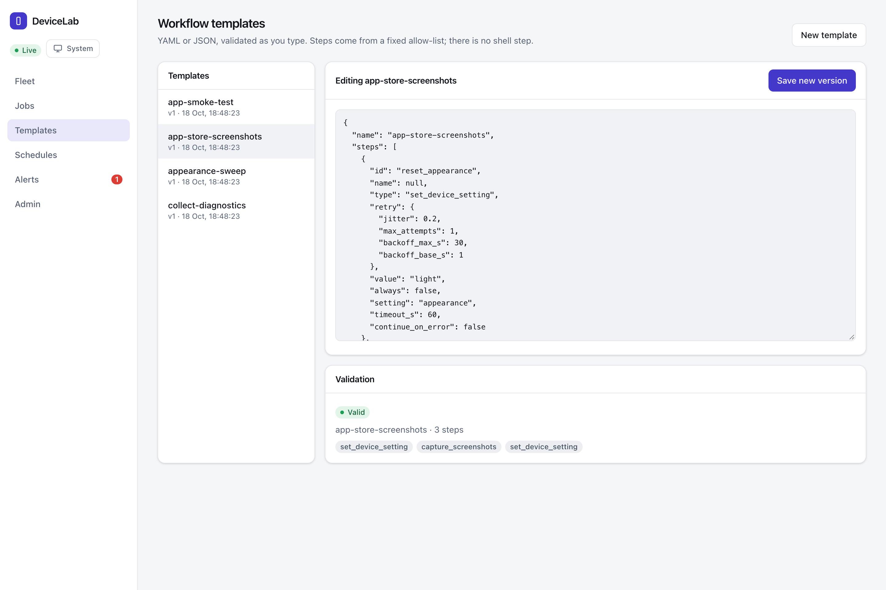 |
| 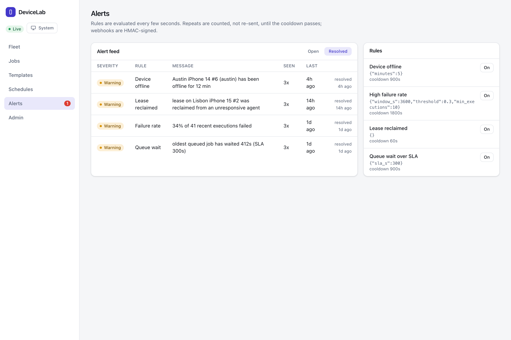 | 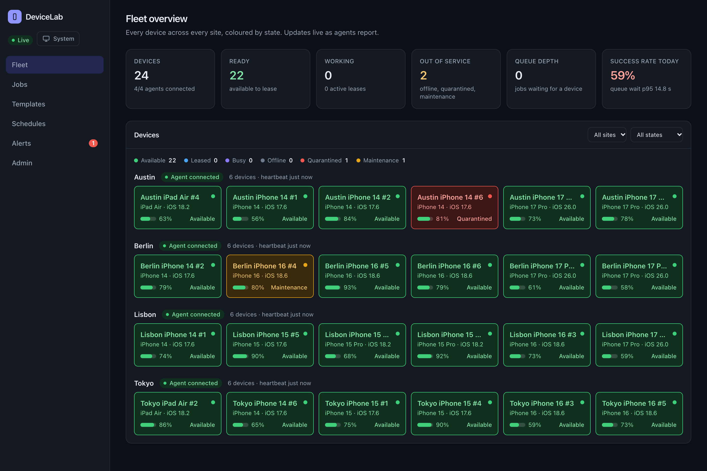 |
| 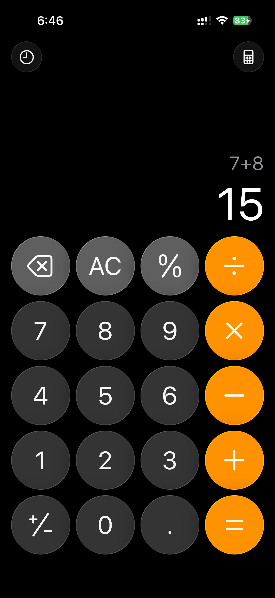 | 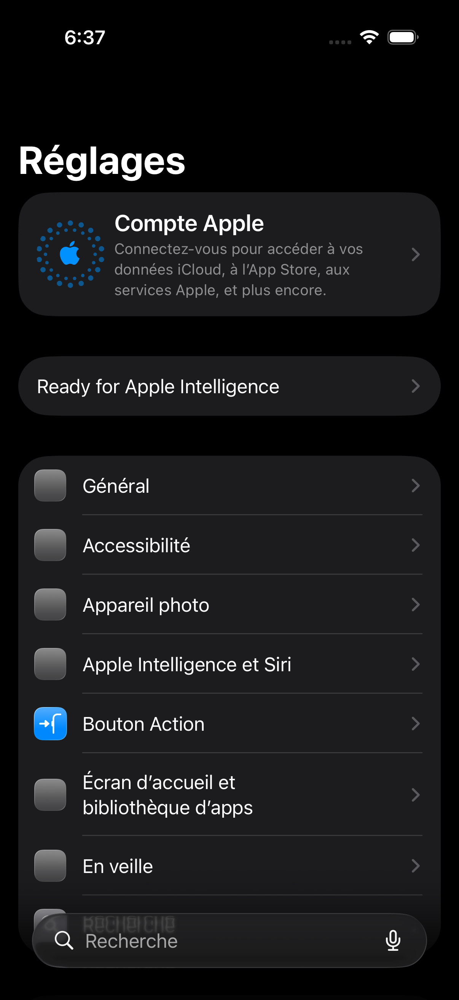 |

*The bottom row is real: a physical iPhone running the Calculator check, and the dark-mode Settings capture from the simulator run. Other screenshots show the simulated fleet (the placeholder device screens are labelled SIMULATED). The failure-recovery page is a job whose first attempt failed with an infrastructure error and which was requeued on a different device.*

## Architecture

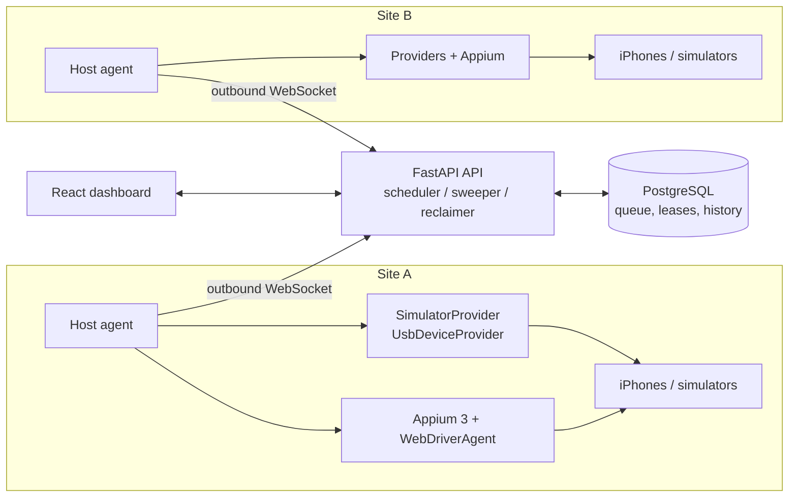

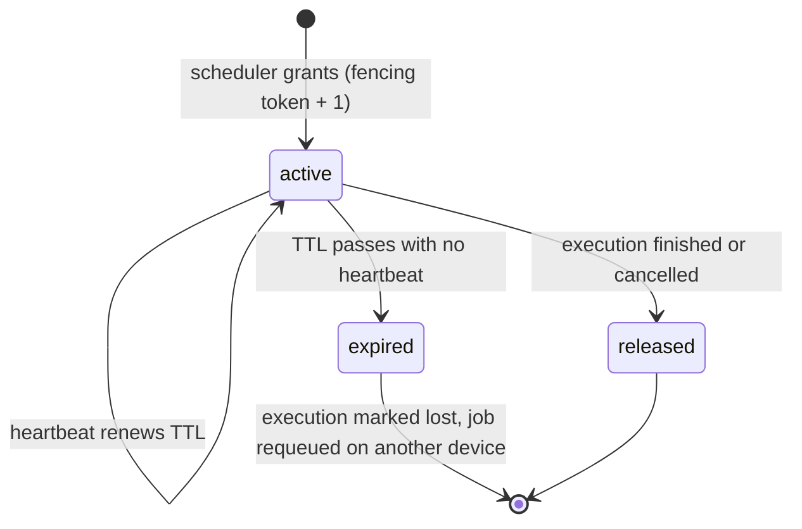

Layers: `domain/` (pure rules), `application/` (use cases over ports), `adapters/` (Postgres, providers, Appium, storage, alerts), `api/` (thin routers and the agent hub), `agent/` (the host agent). The agent and control plane share a versioned, schema-tested protocol package. Full write-up and rejected alternatives in [docs/ARCHITECTURE.md](docs/ARCHITECTURE.md).

## How leasing and recovery work

1. A scheduler tick locks free devices and queued jobs with `SELECT ... FOR UPDATE SKIP LOCKED`, asks a pure function which job gets which devices (priority plus aging, capability match, host limits, health gates), and writes leases and executions in the same transaction. A unique partial index on active leases is the backstop.
2. Each lease carries a **fencing token**. The agent sends it back on every message; the control plane accepts a report only if the lease is still active and the token matches.
3. The agent's heartbeat renews the lease. If heartbeats stop, the reclaimer expires the lease, marks the execution `lost` and requeues the job on a *different* device, exactly once.
4. A brief network drop loses nothing: the agent keeps running, queues its messages, reconnects, and the control plane reconciles what it expects with what the agent reports. A long partition is fenced: the agent's late report is rejected and it stands down.
5. Infrastructure failures (device unreachable, WDA crashed, timeout) retry with backoff, restart the session or reboot between attempts, then requeue elsewhere; after N in a row the device is quarantined until an operator returns it. Test failures (assertion failed, app crashed) are the answer, not a fault, and are never retried into a pass.

## Tech stack

| Area | Choice |
| --- | --- |
| Control plane | Python 3.12+, FastAPI, SQLAlchemy 2 (async), Alembic, PostgreSQL 16, `uv` |
| Queue and leases | Postgres (`SKIP LOCKED`, TTL, fencing); no Redis or Celery |
| Host agent | asyncio service, outbound WebSocket, one-time enrolment |
| UI automation | Appium 3 + `appium-xcuitest-driver` (WebDriverAgent) via the Appium Python client |
| Providers | `SimulatorProvider` (`simctl`), `UsbDeviceProvider` (`devicectl`, libimobiledevice), `FakeFleetProvider` |
| Dashboard | React 19, Vite, TypeScript (strict), TanStack Query and Router, Tailwind 4 |
| Observability | structlog JSON, Prometheus |
| Quality | ruff, `mypy --strict`, pytest + Hypothesis, Vitest + Testing Library, Playwright |

## Quick start

```bash
git clone https://github.com/OwaisMunawar/devicelab && cd devicelab
docker compose up --build
open http://localhost:8080
```

The stack signs the dashboard in with a published demo key and starts an agent that simulates 24 devices across 4 sites. API docs are at <http://localhost:8000/docs>. Stop with `docker compose down -v`.

## Connecting real devices

On a Mac with devices attached (Xcode installed, devices trusted, Developer Mode on):

1. In the dashboard open **Admin, Connect a host**, enter a host name and site, and copy the command it prints. The token is single use and expires in an hour.
2. Install the agent and run it:

   ```bash
   uv sync
   export DEVICELAB_TEAM_ID=<your Apple team id>          # only for physical devices
   uv run devicelab-agent run --server wss://your-host/v1/agent/ws \
     --host-name mac-lab-1 --enrol-token <token> --provider usb \
     --appium-home .cache/appium --derived-data .cache/wda
   ```

   Use `--provider simulator` for simulators (it only manages simulators whose name starts with `DeviceLab`), `--usb-allow <udid>` to restrict which devices the agent will touch, and `--app-root` to name the one directory `install_app` may read from.
3. The agent stores its credential (mode 0600) and reconnects on its own. Appium needs Node 22.12+ or 24; `APPIUM_HOME` and the WebDriverAgent derived data path are kept under `.cache/` so cleanup is deleting one folder.

See [docs/HARDWARE_VALIDATION.md](docs/HARDWARE_VALIDATION.md) for the validation checklist and what has and has not been run on physical hardware.

## Measured scale results

`uv run python -m scripts.loadtest --devices 50 --sites 5 --jobs 520` starts the real API with the scheduler running, connects five agents (one per site) over WebSocket, submits 525 jobs through the REST API with mixed priorities and constraints (site, iOS version, model family, label, two-device jobs, five that can never match, a 2% simulated step failure rate), then audits the database. Raw output: [docs/loadtest-result.json](docs/loadtest-result.json). Measured on a MacBook with Postgres in Docker, simulated steps of 50 to 150 ms.

| Metric | Result |
| --- | --- |
| Fleet / workload | 50 devices, 5 sites, 525 jobs |
| Completed | 520 succeeded, 0 failed, 5 unsatisfiable left queued (no head-of-line blocking) |
| Double leases | **0** (history audit and a 50 ms poll of the live lease table) |
| Wall time | 23.2 s, 22.4 jobs/s completed |
| Queue wait p50 / p95 / p99 | 9.8 s / 18.1 s / 19.5 s |
| Queue wait, priority 7+ vs 0-2 (p50) | 3.5 s vs 16.9 s (priority and aging working) |
| Scheduler tick p50 / p95 / p99 | 29 ms / 88 ms / 192 ms |
| Assignment capacity while ticking | about 49 per second |
| Recoveries during the run | 23 jobs requeued on another device |
| Postgres connections | mean 27, max 32 |
| Postgres CPU (Docker, % of one core) | mean 45%, max 179% |
| API submit latency p50 / p95 | 126 ms / 433 ms |

The queue wait is dominated by the workload (525 jobs on 50 devices), not by the scheduler. The chaos suite (`pytest tests/chaos`) kills agents mid-step, drops and restores connections, restarts the API during a run and corrupts a device's health, and asserts that jobs are requeued exactly once, leases are reclaimed and the database converges; all six scenarios pass. Capacity arithmetic for 10, 50 and 200+ devices is in [docs/SCALING.md](docs/SCALING.md).

## Verified on / not verified on

| Target | Status |
| --- | --- |
| iOS Simulator (iOS 26.5), real control plane to agent to `SimulatorProvider` to Appium 3 / WebDriverAgent | **Verified.** A 9-step workflow (appearance, locale, screenshots, logs) ran end to end; artifacts in the dashboard. |
| Simulated fleet (`FakeFleetProvider`), 24 devices in demo mode, 50 in the load test | **Verified**, including chaos scenarios. |
| `UsbDeviceProvider` against recorded `idevice_id` / `ideviceinfo` output | **Verified** by unit tests (output anonymised). |
| Physical iPhone 15 (iOS 26.6.1) over USB: read-only inventory and health polling, and one Calculator workflow (launch, tap 7 + 8 =, assert 15, screenshot) through Appium / WebDriverAgent | **Verified**, one device, one run. Automation was limited to Calculator; see [HARDWARE_VALIDATION.md](docs/HARDWARE_VALIDATION.md). |
| Multiple physical iPhones, Wi-Fi (network) devices, iOS 16 and older, `devicectl install`, log capture and settings changes on a physical device | **Not verified.** |
| S3 artifact storage against a real S3 or MinIO endpoint | **Not verified**; unit-tested with a stub client. |
| Postgres on production hardware, more than one API replica | **Not verified.** |

## Quality

- Backend: `ruff` and `mypy --strict` clean; 177 pytest tests against a real Postgres; **97% line coverage on `domain` and `application`** (gate: 90%, enforced in CI); Hypothesis property tests on the scheduler (no double assignment, capability and host-limit invariants, input-order independence); a committed protocol JSON schema that fails the build on accidental change.
- Dashboard: TypeScript strict, no `any`, ESLint and Prettier clean, Vitest and Testing Library tests for the shared UI kit and key components, a Playwright smoke test against the compose stack.
- CI (`.github/workflows/ci.yml`): lint, types, tests with the coverage gate, scheduler properties, chaos and load, web checks, and the compose smoke test. Actions are pinned to exact release tags and checked with `actionlint`.
- Security: see [docs/SECURITY.md](docs/SECURITY.md) for the threat model and known limitations.

## Roadmap

- Presigned-URL artifact uploads and video capture.
- Postgres `LISTEN/NOTIFY` event bus for multiple API replicas; per-region schedulers.
- Log and health-sample pruning and monthly partitioning.
- Network (Wi-Fi) devices and a go-ios + WDA adapter behind the `UiDriver` port.
- Workflow step for installing from an artifact store; richer assertions (image diff).
- Keyset pagination for large histories; OIDC for dashboard sign-in.

## License and author

MIT, see [LICENSE](LICENSE). Contributions: see [CONTRIBUTING.md](CONTRIBUTING.md).

Built by [Owais Munawwar](https://github.com/OwaisMunawar). I'm available for React Native, AI and iOS work on [Upwork](https://www.upwork.com/freelancers/owaism11).
