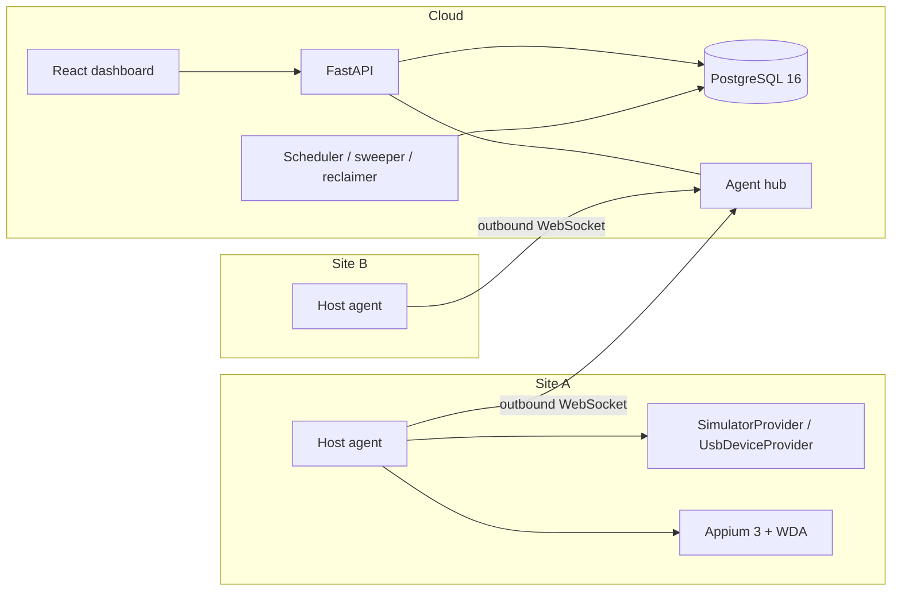

# Architecture

DeviceLab is a control plane plus a thin agent on every Mac that has devices attached. This
document explains the shape of the code and, more usefully, the decisions behind it and the
alternatives that lost.

## Shape

The backend is hexagonal. Dependencies point inwards only:

| Layer | Contents | May import |
| --- | --- | --- |
| `domain/` | scheduler, lease and fencing rules, state machines, failure classification and recovery policy, workflow models, cron and misfire logic, alert rules | itself, pydantic, yaml, cronsim |
| `application/` | use cases (`FleetService`, `SchedulerService`, `ExecutionService`, ...), repository and gateway **ports** (protocols), records | `domain`, `protocol` |
| `adapters/` | SQLAlchemy repositories and migrations, device providers, Appium driver, artifact stores, webhook delivery | everything inward |
| `api/` | thin FastAPI routers, the agent WebSocket hub, auth dependencies, background loops | `application`, `container` |
| `agent/` | the host agent: connection, step runner, executor | `protocol`, `domain`, providers |
| `protocol/` | the versioned agent and control-plane message types, shared by both ends | `domain` workflow types |

Nothing in `domain` or `application` holds a singleton: the clock, id factory, unit of work,
artifact store, event publisher and agent gateway are all injected as protocols, wired once
in `container.py`. That is what lets the use-case tests run against real Postgres with a
fake clock and a recording gateway, and lets the same use cases serve the API, the agent hub
and the CLI.

## ADR-001: agents connect outbound; no inbound SSH or VPN

**Context.** Devices sit in offices and homes behind NAT and corporate firewalls. The control
plane needs to start work on them and watch them.

**Decision.** Each host agent dials the control plane over a WebSocket (`wss://` in
production) and keeps it open. Enrolment uses a one-time, expiring token; afterwards the
agent holds a long-lived credential (stored 0600) and the server stores only its hash. All
traffic (assignments, heartbeats, logs, artifacts) is multiplexed over that one connection.

**Consequences.** A site needs only outbound HTTPS. There is nothing to patch or expose on
the Mac, no per-site VPN to operate, and an agent behind a flaky link reconnects with backoff
without anyone touching it. The cost is that the control plane cannot reach a device whose
agent is down, which is the correct answer anyway, and that the server holds one socket per
host (a few dozen, not thousands; see `SCALING.md`).

**Rejected.**
- *Inbound SSH or a VPN mesh to every Mac.* Needs firewall changes at every site, key
  distribution and rotation, and turns the control plane into an attack surface on each
  network it reaches into.
- *Polling over HTTPS.* Works through NAT but makes cancellation and live logs awkward and
  adds latency to every assignment. A WebSocket gives push in both directions for free.
- *A message broker at each site.* One more thing to run per location for no gain at this size.

## ADR-002: the queue and the leases live in Postgres

**Context.** Jobs need a priority queue with fairness, exclusive device allocation, and
survival of crashes of any single process.

**Decision.** `jobs`, `leases` and `devices` are plain tables. A scheduler tick is one
transaction: `SELECT ... FOR UPDATE SKIP LOCKED` on queued jobs and on available devices, a
pure function (`plan_assignments`) decides who gets what, and the leases are written in the
same transaction. A partial unique index (`UNIQUE (device_id) WHERE state = 'active'`) makes
a double lease impossible even if every line of application code above it were wrong.

**Consequences.** There is one source of truth and one thing to back up. Assignment is atomic
with the state it depends on: there is no window in which Redis says a device is free while
Postgres says it is leased. Throughput is bounded by Postgres, which is ample for tens to a
few hundred devices (measured numbers are in the README and `SCALING.md`).

**Rejected.**
- *Redis or Celery.* A second store means reconciling two views of "who has this device"
  after every crash. Celery's model (ack on delivery, visibility timeouts) is also a poor fit
  for leases that must be renewed and fenced.
- *Temporal.* Excellent for long-running business workflows, but it is a platform to operate,
  and the part we need (exclusive allocation of physical devices with health-aware placement)
  would still be ours to write. Workflows here are short, linear and fully described by a
  validated template.
- *An in-memory scheduler with periodic snapshots.* Loses the "restart the API mid-run and
  converge" property that the chaos tests assert.

## ADR-003: leases with TTL, heartbeat renewal and fencing tokens

**Context.** An agent can freeze, be partitioned, or die, and its Mac may come back minutes
later still believing it owns a device that has since been reassigned.

**Decision.** A lease has a TTL (default 45 s) renewed by the agent's heartbeat (10 s). Every
grant bumps a per-device **fencing token**, which travels in the assignment and in every
message the agent sends back. The control plane accepts a report only if the lease is still
active and the token matches. A reclaimer takes expired leases back, marks the execution
`lost`, and requeues the job on a different device, exactly once (the execution row is
locked and its terminal state checked first).

**Consequences.** A partitioned agent is harmless: its late `execution_finished` is rejected
with `stale_fence`, and the agent is told to stand down. A brief drop (shorter than the TTL)
loses nothing: the agent keeps running, queues its messages, and resumes after reconnect.

**Rejected.** *Heartbeat-only liveness without fencing* (a zombie can still write results);
*sticky one-way assignment with no TTL* (a dead host holds devices forever).

## ADR-004: Appium + WebDriverAgent, behind a UI driver port

**Decision.** UI automation goes through Appium 3 with `appium-xcuitest-driver`, which builds
and manages WebDriverAgent, via the Appium Python client. Device-level actions (install,
launch, appearance, logs) use `simctl` and `devicectl` through a provider interface, so the
UI layer is optional per step.

**Why not the alternatives.** *go-ios + WDA directly* gives finer control and fewer
moving parts at runtime, but you then own WDA building, signing, port forwarding and the
WebDriver protocol client; the job description names Appium, and the Appium ecosystem
(selectors, waits, community fixes) is what a QA team already knows. *DeviceFarmer/STF* is
a device-sharing portal for humans (remote screen, adb/usb forwarding); it has no workflow
engine, scheduling or failure recovery, and its iOS support is far weaker than its Android
support. The `UiDriver` port keeps go-ios open as a future adapter.

## ADR-005: a typed, allow-listed workflow DSL, not scripts

**Decision.** Templates are YAML or JSON validated by Pydantic into a closed union of step
types: `install_app`, `launch_app`, `terminate_app`, `appium_actions`, `screenshot`,
`capture_screenshots`, `collect_logs`, `set_device_setting` (appearance, locale, time zone
only) and `reboot_device`. Parameters use a deliberately tiny `{{ params.x }}` substitution
(no expressions), re-validated after rendering. The agent executes steps with a closed
`match`; an unknown type cannot run even if the control plane sent one.

**Consequences.** Templates are reviewable, diffable and safe to accept from many authors.
`appium_actions` covers tap, type, swipe, wait and assert-text, which is enough for smoke
tests and store-screenshot capture. Anything outside that is a new step type, written in
code and reviewed, rather than a string somebody pasted into a form.

**Rejected.** *Arbitrary Python or shell steps.* Convenient, and the end of any claim that
the agent only does what the lab owner intended: every template author would hold a remote
shell on every Mac in the fleet.

## ADR-006: one scheduler, designed to shard

**Decision.** A single scheduler loop runs inside the API process. It is safe to run more than
one (SKIP LOCKED partitions the rows, the unique index is the backstop), but the default
deployment runs one because that is also the simplest to reason about and, per the load
test, nowhere near the limit.

**Where it would shard.** First, by site or region: jobs and devices both carry a site, so a
scheduler per region is a `WHERE` clause. Second, by running several schedulers against the
same database and accepting approximate global priority ordering. The agent hub would then
need LISTEN/NOTIFY (or a broker) to route dispatch wake-ups to the replica that holds the
socket; the event bus is already behind a port. See `SCALING.md`.

## ADR-007: artifact storage behind an interface

Screenshots, logs and results go through `ArtifactStore` (`put/get/delete`). `LocalArtifactStore`
is the default (fine for a single host and for the demo); `S3ArtifactStore` speaks to any
S3-compatible endpoint. Rows in Postgres carry size, type and an expiry derived from the
retention setting; a periodic job deletes the blob first and the row second, so a crash
leaves a retry rather than an orphan. Uploads ride the agent WebSocket (base64, 20 MB cap):
simple and firewall-friendly, and the first thing to change (to presigned URLs) if screenshots
become large or video is added.

## ADR-008: one lock order everywhere

The first version of the sweeper and the reclaimer deadlocked under chaos: one path locked a
lease and then an execution, another locked them the other way round. The rule now is
**job, execution, lease, device**, enforced by routing every execution ending through
`Lifecycle.lock_execution`, and by keeping multi-row device updates in id order and in their
own short transactions. The chaos suite is what found this, which is the reason it exists.

## ADR-009: health history is sampled, not logged per heartbeat

At 200 devices and a 10 s heartbeat, logging every report is 20 inserts a second for data
nobody reads at that resolution. Samples are written on a meaningful change (battery moves
by 5 points, thermal or connectivity changes) or every five minutes, which keeps the
timeline useful and the write rate flat. The latest values live on the device row.
